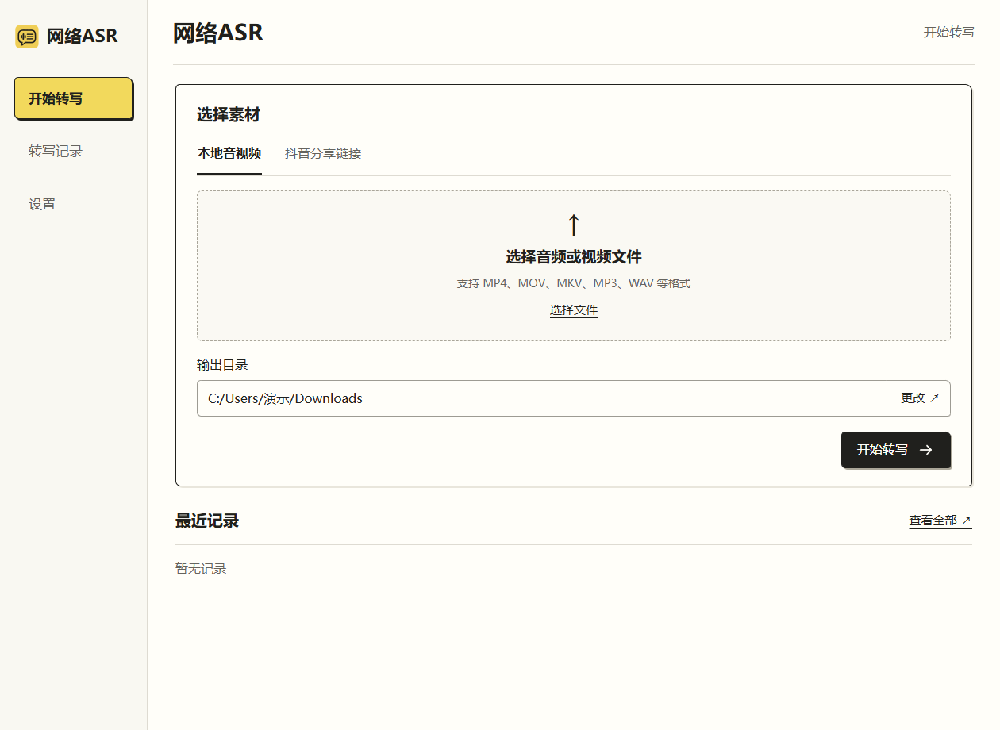

# 网络ASR

我做这个工具，是想把音视频转文字这件事放回桌面上：选文件、贴链接、看文字稿，不需要再部署一套网站。

它负责整理素材、提取音频和保存记录，识别交给你自己的火山引擎账号。目前只接入火山 Flash 协议，软件本身没有账号、积分或充值功能。



## 下载与使用

到本仓库的 [Releases](https://github.com/Zdanta/network-asr/releases/latest) 下载 `NetworkASR-v1.2.0-windows-x64.zip`，完整解压后双击 `网络ASR.exe`。不要在压缩包里直接运行，也不要只复制 exe。

发布包面向 **Windows 10 1809 及以上 / Windows 11，64 位 x64**，内置 Python、Qt WebEngine、FFmpeg/FFprobe 和抖音解析浏览器，无需安装 Python、Node、WebView2 或单独配置 FFmpeg。包会比较大，这是携带运行时换来的便利。暂不提供 Windows 7、32 位或原生 ARM64 版本。

程序可以离线打开；调用 ASR 和下载抖音素材需要联网。这不是离线识别模型。

1. 在“设置”填写自己的火山语音 API Key，保存配置。
2. 选择本地音视频，或粘贴抖音链接/完整分享文案。
3. 点击“开始转写”，在记录页查看、复制或导出 TXT。

给 Agent 的安装提示词：**帮我把github上的https://github.com/Zdanta/network-asr安装到我的电脑上**

Agent 安装时可以参考 [安装说明](docs/INSTALL_FOR_AGENTS.md)，优先下载 Release，不必从源码搭建环境。

## 我推荐的识别服务

推荐 **火山引擎 · 豆包语音「大模型录音文件识别极速版」**，对应 `volc.bigasr.auc_turbo`。本工具已经按它的请求协议适配，适合短视频、口播、课程片段和采访录音等文件转写。嘈杂环境、多人重叠说话、音乐占比高或口音较重时，仍需人工校对；不要把它当作保证准确的正式记录。

默认配置如下，不用自行找模型地址：

| 配置 | 值 |
| --- | --- |
| 接口地址 | `https://openspeech.bytedance.com/api/v3/auc/bigmodel/recognize/flash` |
| 资源 ID | `volc.bigasr.auc_turbo` |
| 模型名称 | `bigmodel` |
| 超时 | `180` 秒，可按网络和素材长度调整 |

目前没有适配其他服务商，单独改 URL 不能变成通用 ASR 客户端。

### 怎么获取 API Key

1. 登录 [火山引擎控制台](https://console.volcengine.com/speech/new/)，按要求完成账号认证。
2. 在豆包语音控制台选择要使用的项目，进入“API 服务中心”或“开通管理”，开通**大模型录音文件识别极速版**。确认有对应资源权限。
3. 在同一项目的“API 管理 / API Key 管理”中创建或复制 Key，也可从[默认项目 Key 页面](https://console.volcengine.com/speech/new/setting/apikeys?projectName=default)进入。
4. 将 Key 填进软件“设置 → API Key”，保存即可。不同项目的 Key、资源权限和额度需要对应。

这里需要的是**豆包语音 API Key**，不是火山方舟大语言模型的 Key，也不是旧控制台的 APP ID 或 Access Token。[官方控制台指引](https://docs.volcengine.com/docs/doubao-voice/console-guidance?lang=zh)和 [Key 使用说明](https://docs.volcengine.com/docs/DoubaoVoice/APIKeyUsage?lang=zh)可供核对。

### 大概多少钱、够用多久

截至 **2026-11-14**，官方列出的大模型录音文件识别极速版按量价为 **4.5 元/音频小时**。以下按这个单价换算，便于估算：

| 素材或预算 | 参考费用 / 可处理时长 |
| --- | --- |
| 1 分钟口播 | 约 0.075 元 |
| 10 分钟视频 | 约 0.75 元 |
| 1 小时录音 | 约 4.5 元 |
| 10 元预算 | 约 2 小时 13 分钟，或约 133 段 1 分钟口播 |
| 10 小时素材 | 约 45 元 |

这是按音频时长的粗算，不是本软件向你收费。实际账单还会受服务商计费粒度、试用额度、资源包及价格调整影响；以你账号的控制台账单和[官方计费说明](https://docs.volcengine.com/docs/doubao-voice/billing-instructions?lang=zh)为准。新用户是否有免费额度、额度多少和有效期，以开通页显示为准。不要把旧版“录音文件识别极速版”的价格与“大模型极速版”混用。

### 素材限制

[官方 Flash 接口](https://docs.volcengine.com/docs/doubao-voice/large-model-recording-file-lite-recognition-api?lang=en)上限为 **100MB、2 小时**。本工具会将素材规范成 16kHz 单声道 WAV；转换后的 WAV 超过 100MB 会在请求前拦截，因此本版较长录音应先分段，建议每段不超过 50 分钟。后续可以再做更长文件的分段处理。

抖音优先尝试无水印地址，但不保证每条都能下载。私密内容、登录限制、失效链接和平台风控都可能导致失败；找不到可确认的原声音轨时会报错，不会拿背景音乐代替。请只处理你有权使用的内容。

## 数据、升级与删除

配置和历史位于 `%LOCALAPPDATA%/AiVideoDesktop/`，包括 `config.json`、`history.db`、`logs`、`cache`。沿用这个目录名是为了兼容已有数据。

API Key 使用当前 Windows 用户的 DPAPI 加密，不随源码或发布包分发。设置页留空会保留已有 Key；配置复制到其他 Windows 账户后，通常需要重新填写。

下载文件长期保存在所选输出目录的 `AiVideoDesktop下载/<任务号>/` 中，提取用 WAV 在任务结束后清理。删除记录不会删除原始文件；“清理下载文件”是独立操作，只针对应用下载的文件。升级时关闭旧版、完整解压新版即可，不要删除上述用户数据目录。

## 从源码运行

普通用户直接用 Release。开发环境需要 Windows x64、Python 3.12 和 FFmpeg/FFprobe：

```powershell
git clone https://github.com/Zdanta/network-asr
cd network-asr
py -3.12 -m venv .venv
.\.venv\Scripts\python -m pip install -r requirements-dev.txt
.\.venv\Scripts\python -m playwright install chromium
.\.venv\Scripts\python run.py
```

主要目录：`app/ui` 是本地桥接口，`resources/ui` 是 HTML 界面，`services` 编排任务，`providers/asr` 处理火山协议，`media` 处理素材，`repositories` 保存 SQLite，`core` 管理配置和运行路径。

```powershell
python -m unittest discover -s tests -v
python -m ruff check app tests scripts
python scripts/html_check.py
python run.py --smoke-test diagnostics.json
powershell -ExecutionPolicy Bypass -File scripts/build.ps1
```

构建脚本负责准备并校验运行时，正式包保持 onedir 结构。构建方法和独立环境检查见 [构建说明](docs/BUILD.md)。

## 常见问题

- **密钥错误或无权限**：核对是否为豆包语音 Key、模型是否开通、项目是否匹配、额度或余额是否可用。
- **请求超时**：检查网络，适当增加超时或缩短素材。软件不会自动重试收费请求，失败后由你决定是否重试。
- **下载失败**：先确认分享链接公开可访问。平台页面有变化时，可以下载到本地后再导入。
- **程序没打开**：确认下载的是 x64 完整包并已解压。运行 `网络ASR.exe --smoke-test <报告绝对路径>` 可生成不调用 ASR 的诊断报告。
- **系统提示未知发布者**：目前未购买代码签名证书。请从本仓库 Release 获取并核对 SHA256，不要下载来路不明的修改版。

我的代码使用 MIT 许可证。发行包中的 Qt/PySide、Chromium、FFmpeg 等保留各自许可和版权，见 [第三方说明](THIRD_PARTY_NOTICES.md)。
